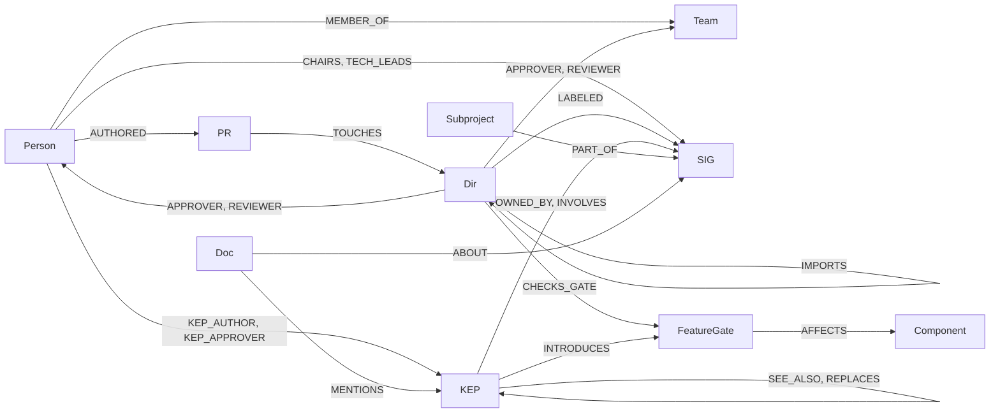
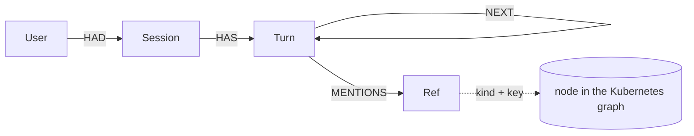

# Kortex: the Kubernetes org brain

An agent that answers questions about how the Kubernetes project works as a company (who owns code, which design
decisions constrain it, what could break, who knows it) by walking a **FalkorDB** graph of the project.

- **Live app:** https://kortex-falkordb.streamlit.app (5 free questions per session; Explore, Memory and Data need no key)
- **Demo video:** _link in the submission_ · generated by [`demo/record_demo.py`](demo/record_demo.py)
- **Tracks:** Company Brain (primary), Agents That Act on Connected Data, Agent Memory and Coordination
- Built for [Graph Hacks](https://www.wemakedevs.org/hackathons/falkordb) by WeMakeDevs · [full details](docs/DETAILS.md)

## The graph

About 7,200 nodes and 26,900 relationships, loaded from the public `kubernetes`, `enhancements` and `community`
repositories (`ingest.py`): OWNERS files, Go imports, feature-gate checks, KEPs, merged PRs, SIG documents.



`Dir` is a folder of kubernetes/kubernetes, `KEP` a design decision, `SIG` a department, `Component` a binary
(kubelet, kube-scheduler), `Doc` a SIG README, charter or annual report (full-text indexed). People are stored
only as GitHub handles.

Each user's conversation memory is a **separate graph** (`k8s_memory_<hash>`), so the shared graph never holds
anyone's questions:



## How the agent queries it

The agent (LangChain, any tool-calling model) has 19 tools. Each one is a Cypher query in
[`queries.py`](queries.py); the model only sees what those queries return.

| Question | Tool | Graph work in FalkorDB |
|---|---|---|
| Who must approve code behind KEP-2837? | `decision_to_approvers` | KEP → `INTRODUCES` gate ← `CHECKS_GATE` code → `IN*` up to the nearest OWNERS → `APPROVER` → team `MEMBER_OF` people, in one query |
| Who should review a change to `pkg/kubelet/eviction`? | `best_reviewers` | inherited approvers (variable-length `IN*0..` walk, cut at `no_parent_owners`) ∩ authors of PRs that `TOUCHES` the folder |
| What is the riskiest code in `pkg/kubelet`? | `critical_code` | `algo.pageRank` and `algo.betweenness` over `IMPORTS`, joined with each package's approver count |
| What could break if I change it? | `blast_radius` | reverse `IMPORTS`, one hop per query until nothing new, mapped to `Component` binaries |
| Which decisions constrain this code? | `design_constraints` | folder → gates it checks → KEPs that introduced them → linked KEPs |
| What did SIG Node's 2024 annual report say? | `search_docs`, `read_doc` | `db.idx.fulltext.queryNodes('Doc', …)`, then the doc's `ABOUT`/`MENTIONS` links |
| What did I ask last time, and what changed? | `recall_memory`, `recent_changes` | topic → nodes and their neighbours in the Kubernetes graph → turns that `MENTIONS` them in the memory graph → PRs and KEPs since that turn's date |
| Anything else | `run_cypher` | model-written Cypher, read-only (`GRAPH.RO_QUERY`), 10 s timeout |

Inherited ownership, the core of most answers:

```cypher
MATCH p = (d:Dir {path: $path})-[:IN*0..]->(a:Dir)
WHERE none(n IN nodes(p)[0..size(nodes(p)) - 1] WHERE coalesce(n.no_parent_owners, false))
MATCH (a)-[:APPROVER]->(o)
OPTIONAL MATCH (m:Person)-[:MEMBER_OF]->(o:Team)
RETURN a.path AS granted_by, length(p) AS levels_up, coalesce(o.handle, o.name) AS owner, collect(m.handle) AS team_members
ORDER BY levels_up
```

## The graph does the work

- **Every answer is graph traversals.** The prompt allows answers only from tool results, and every tool is Cypher
  on FalkorDB: inherited OWNERS walks, multi-hop KEP → code → people paths, PageRank and betweenness, full-text
  search. There is no vector store and no document dump in the prompt.
- **You can see it.** The console beside the chat streams each model call, each tool and every Cypher query with
  its parameters and the rows FalkorDB returned. Every answer ends with the subgraph it used (click a node for its
  profile; switch layouts; open it full screen).
- **Names the graph did not return are flagged.** People, KEPs and PRs in an answer link to GitHub only if a tool
  returned them this turn; anything else is marked "Not from the graph", and stored that way in memory.
- **No model needed to check it.** The Explore page runs the same tools directly on any folder, KEP, person, SIG
  or document. The Data page shows the schema as found in the data and the whole graph grouped by SIG; click a
  SIG to open its cluster (leads, subprojects, KEPs, folders, annual reports).
- **Memory is a graph walk too.** Recall goes from a topic to its nodes and neighbours in the Kubernetes graph,
  then to the user's earlier turns that point at them, and says why each one was recalled.

## Run it

Needs Docker and [uv](https://docs.astral.sh/uv/).

```bash
docker run -d --name falkordb -p 127.0.0.1:6379:6379 -p 127.0.0.1:3000:3000 -e REDIS_ARGS="--appendonly yes" -v falkordb_data:/var/lib/falkordb/data falkordb/falkordb:latest
cp .env.example .env    # pick a model (OpenRouter, Anthropic, Groq, OpenAI or Bedrock) and add its key
uv run streamlit run app.py
```

On first start the app loads the bundled snapshot of the graph into FalkorDB (about half a minute). To rebuild it
from the source repositories, see [full details](docs/DETAILS.md#rebuilding-the-graph-from-the-source-repositories).

## Stack and notes

FalkorDB (local Docker, or FalkorDB Cloud for the live app) · LangChain agent · Streamlit with a Cytoscape.js
graph component · OpenRouter by default.

- **Data:** public Kubernetes repositories (Apache-2.0). Names and e-mails are dropped or replaced; people appear
  only as GitHub handles.
- **Security:** model-written Cypher is read-only with a timeout; visitors' API keys stay in their browser session.
- **AI assistance:** most of the code was written with [Claude Code](https://claude.com/claude-code), directed and
  reviewed by the author; commits carry a `Co-Authored-By: Claude` line. The demo's voice-over is AI-generated.
